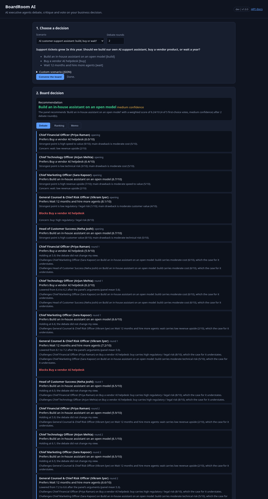
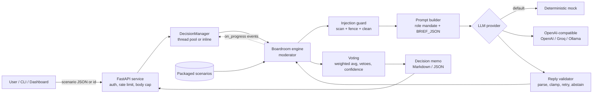
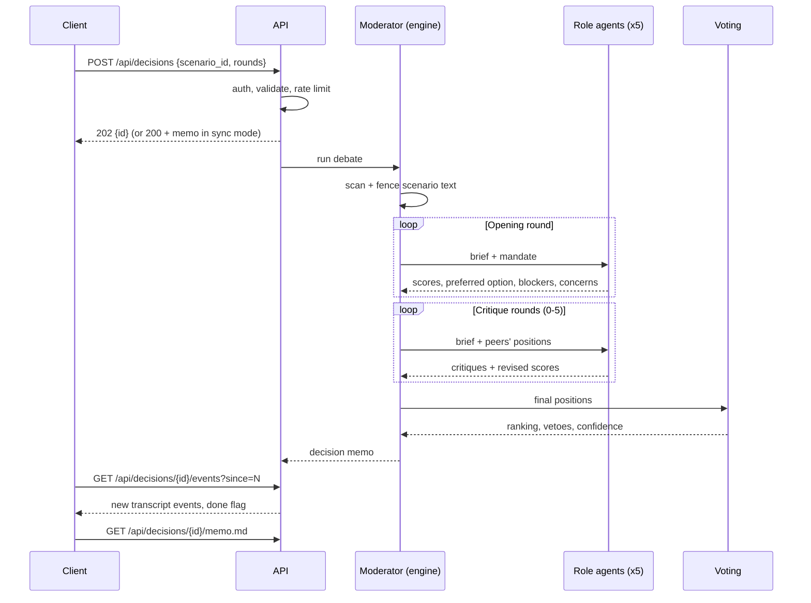
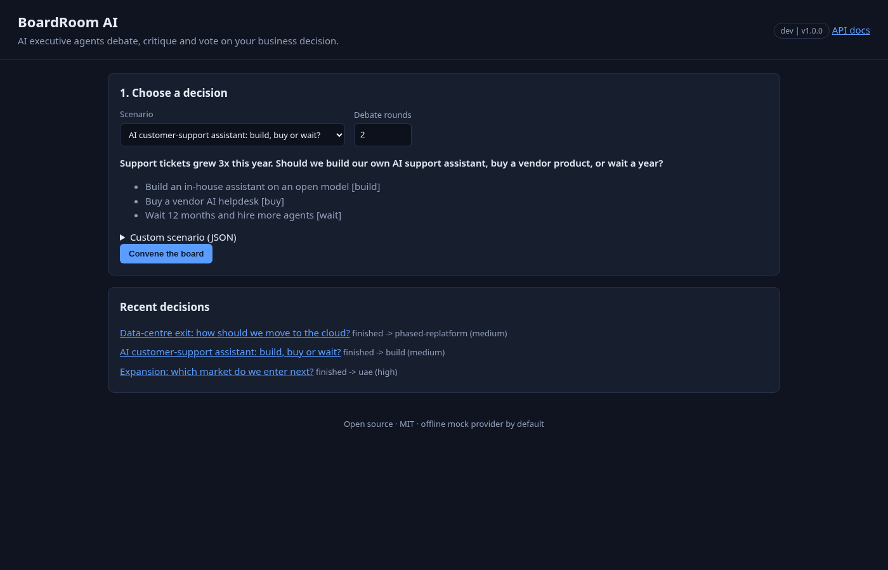
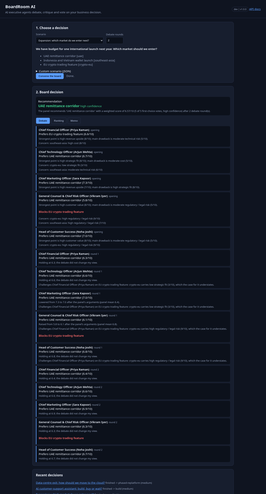
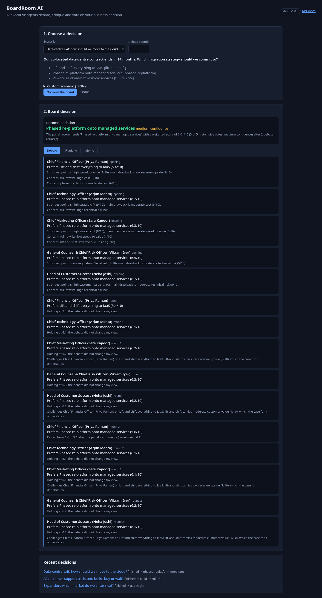

# BoardRoom AI — Multi-Agent Business Decision Engine

[](https://github.com/bharatkumar00797/boardroom-ai-multi-agent/actions/workflows/ci.yml)

[](LICENSE)


> **This is an AI project.** BoardRoom AI is an LLM multi-agent system: five AI executive
> agents with different mandates debate a business decision in moderated rounds, critique each
> other, revise their positions and vote. A deterministic moderator turns the debate into an
> auditable decision memo. It runs fully offline with a deterministic mock model, or against any
> OpenAI-compatible LLM (OpenAI, Groq, Ollama).



## The problem

Big decisions (build vs buy, which market to enter, how to migrate to the cloud) suffer when one
perspective dominates: finance optimises cost, engineering optimises risk, sales optimises
growth, and legal concerns surface too late. Asking a single LLM "what should we do?" gives one
confident, unexplained answer that is easy to manipulate through the prompt.

BoardRoom AI forces the trade-offs into the open. Each agent argues from a written mandate, has
to respond to its colleagues' arguments, and the final call is made by transparent arithmetic,
not by whichever model sounded most confident. The output is a memo a human leadership team
can read, challenge and act on.

## Features

- **Five executive agents** — CFO, CTO, CMO, General Counsel & Chief Risk Officer, Head of
  Customer Success — each with signed priorities over seven option attributes and a vote weight.
- **Moderated debate** — opening statements, then 0-5 critique rounds where each agent reads
  the panel's positions, challenges the weakest argument and may revise its scores.
- **Weighted voting** — vote-weighted average score per option, first-choice votes, panel
  spread, and a high / medium / low confidence label from margin and agreement.
- **Veto** — the General Counsel can block any option that crosses a legal red line; blocked
  options sink to the bottom of the ranking no matter how well they score.
- **Decision memo** — recommendation, ranking, full transcript, dissent, risks, conditions,
  next steps and security flags, as Markdown or JSON.
- **Prompt-injection guard** — scenario text is scanned, flagged and fenced as untrusted data;
  model replies are validated and clamped before they can affect a vote.
- **Pluggable LLMs** — deterministic offline `mock` (default), OpenAI, Groq, Ollama or any
  OpenAI-compatible endpoint, with retries and one corrective re-prompt for bad replies.
- **CLI + REST API + dashboard** — `boardroom run`, `boardroom serve`, async or sync debates,
  event polling, OpenAPI docs, and a no-build web dashboard with a live transcript.
- **Hardened service** — API keys, public-demo mode, rate limits, body cap, strict CSP.
- **Deploy anywhere** — Docker, docker compose, Render, Fly.io, Railway and Vercel configs.

## Architecture



### One debate, step by step



## How it works

1. **Scenario.** A decision has a question, context and 2-6 options. Each option is rated
   0-10 on `cost`, `revenue_upside`, `strategic_fit`, `speed_to_value`, `technical_risk`,
   `regulatory_risk` and `customer_value`. The schema is strict (`extra=forbid`, length caps).
2. **Guard.** Free text is scanned for injection patterns; hits become `security_flags` in the
   memo. The text is then wrapped in `<untrusted_scenario>` tags with look-alike tags defanged.
3. **Opening round.** Every agent gets a system prompt with its mandate, priorities and the
   rule that scenario text is data, never instructions. It returns JSON: a 0-10 score per
   option, a preferred option, rationale, concerns and (Legal only) blocked options.
4. **Critique rounds.** Each agent sees the others' positions, must critique a real peer's
   argument and may revise its scores. The mock moves 30% toward the panel mean when persuaded
   and challenges peers who favour an option it rates lower.
5. **Validation.** Replies are parsed even if wrapped in code fences or prose; unknown option
   ids are dropped, scores clamped to 0-10, blocks from non-blocking roles ignored. A bad reply
   gets one corrective retry; after that the agent abstains (excluded from the vote and
   reported as a risk), so one broken model call cannot sink the decision.
6. **Vote.** Score per option = vote-weighted average (CFO 1.2, CTO 1.1, others 1.0;
   overridable per scenario). Blocked options rank last. Confidence is **high** when the margin
   is >= 1.0 and the spread <= 1.0, **medium** at margin >= 0.4 and spread <= 2.0, else **low**.
7. **Memo.** Recommendation, ranking, transcript, dissent (agents whose first choice lost),
   risks (vetoes, abstentions, low confidence, top concerns), conditions and next steps.

Packaged scenarios and their mock outcomes:

| Scenario | Question | Outcome |
| --- | --- | --- |
| `cloud-migration` | Which migration strategy when the data-centre contract ends? | `phased-replatform` |
| `market-expansion` | Which market next? | `uae`; `crypto-eu` vetoed by Legal |
| `ai-support-build-vs-buy` | Build, buy or wait for an AI support assistant? | `build`; vendor vetoed for data residency; an embedded injection line is flagged and ignored |

## Screenshots

| Start | Debate transcript |
| --- | --- |
|  |  |
|  |  |

## LLM providers

| Provider | `BOARDROOM_PROVIDER` | `BOARDROOM_BASE_URL` | Key |
| --- | --- | --- | --- |
| Mock (default, offline, deterministic) | `mock` | — | none |
| OpenAI | `openai` | `https://api.openai.com/v1` | `BOARDROOM_API_KEY` |
| Groq | `groq` | `https://api.groq.com/openai/v1` | `BOARDROOM_API_KEY` |
| Ollama (local) | `ollama` | `http://localhost:11434/v1` | none |

Any other OpenAI-compatible server works by setting the base URL and `BOARDROOM_MODEL`.

```bash
BOARDROOM_PROVIDER=groq BOARDROOM_BASE_URL=https://api.groq.com/openai/v1 \
BOARDROOM_API_KEY=gsk_... BOARDROOM_MODEL=llama-3.1-8b-instant boardroom run market-expansion
```

## Quickstart

```bash
git clone https://github.com/bharatkumar00797/boardroom-ai-multi-agent.git
cd boardroom-ai-multi-agent
python -m venv .venv && source .venv/bin/activate
pip install -e ".[dev]"

boardroom scenarios
boardroom run cloud-migration                       # Markdown memo; live debate on stderr
boardroom run market-expansion --format json --out memo.json
boardroom run my-decision.json --rounds 3 --roles cfo,cto,legal

boardroom serve --dev                               # dashboard on http://127.0.0.1:8000
```

## REST API

Interactive docs at `/docs` (OpenAPI at `/openapi.json`).

| Method | Path | Description |
| --- | --- | --- |
| `GET` | `/healthz` | Liveness, version, active debates |
| `GET` | `/api/config` | Access mode, providers, round limits, sync mode |
| `GET` | `/api/scenarios`, `/api/scenarios/{id}` | Packaged scenarios |
| `GET` | `/api/roles` | Executive agents, priorities, vote weights |
| `POST` | `/api/decisions` | Start a debate: exactly one of `scenario_id` / `scenario`, plus optional `rounds` (0-5), `roles`, `provider` (`mock`/`configured`). 202 async, 200 with memo + events in sync mode |
| `GET` | `/api/decisions` | Your decisions |
| `GET` | `/api/decisions/{id}` | State and memo |
| `GET` | `/api/decisions/{id}/events?since=N` | Transcript events after cursor `N`, `next_cursor`, `done` |
| `GET` | `/api/decisions/{id}/memo.md` | Memo as Markdown |

```bash
curl -s -X POST localhost:8000/api/decisions -H 'content-type: application/json' \
  -H "X-API-Key: $KEY" -d '{"scenario_id":"market-expansion","rounds":2}'
```

### Access modes

| Mode | When | Allowed |
| --- | --- | --- |
| `api-key` | `BOARDROOM_API_KEYS` set | Every `/api` call needs `X-API-Key` or `Authorization: Bearer`; custom scenarios and the configured provider |
| `dev` | `BOARDROOM_DEV_MODE=true`, no keys | No auth, full access — localhost only |
| `public-demo` | neither | Packaged scenarios + mock provider only; each client sees only its own decisions (hashed IP) |

### Error codes

| Status | Meaning |
| --- | --- |
| 401 | Missing or invalid API key |
| 403 | Not allowed in this mode (custom scenario or real provider in public demo) |
| 404 | Unknown decision (or owned by someone else) / scenario |
| 409 | Memo requested before the debate finished |
| 413 | Body larger than 64 KB |
| 422 | Validation error (schema, unknown scenario/role, both or neither of `scenario_id`/`scenario`) |
| 429 | Rate limit or decision-creation limit hit (`Retry-After` set) |
| 503 | Debate queue full (`Retry-After` set) |

## Security model

**Prompt injection.** Scenario text is attacker-controlled. It is (1) scanned for override,
role-hijack, vote-manipulation, prompt-exfiltration and fake-delimiter patterns and the hits
are surfaced as `security_flags`; (2) wrapped in `<untrusted_scenario>` tags with any
look-alike tags in the text defanged, so it cannot close the fence; (3) covered by a system
rule that the fenced block is data. Most importantly, (4) **the model never decides the
outcome**: it only returns scores, which are validated (known ids only, clamped 0-10, vetoes
only from the blocking role, critiques must target real peers). Ranking, vetoes and confidence
are computed in code. A hijacked agent can at worst move its own clamped scores, which the other
weighted votes dilute and the memo exposes.

**No tools, no side effects.** Agents cannot run code, fetch URLs or touch files; the only
output is a memo.

**HTTP API.** API keys stored as SHA-256 digests and compared in constant time; public-demo mode
restricts anonymous users to packaged scenarios and the mock (no paid-key abuse); sliding-window
rate limits (general + stricter creation limit, only well-formed requests counted); bounded
queue; 64 KB body cap enforced on header and streamed bytes; pydantic `extra=forbid`; strict
CSP (`self` only), `X-Frame-Options: DENY`, `nosniff`, `no-store` on `/api`; CORS off unless
configured; provider keys never returned. The dashboard renders with `textContent` only.
Client IP uses the right-most `X-Forwarded-For` hop and only when `BOARDROOM_TRUST_PROXY=true`.

**Container.** Non-root uid 10001, multi-stage image; compose runs read-only with tmpfs `/tmp`,
`cap_drop: ALL`, `no-new-privileges` and pid/memory/CPU limits.

**Residual risks.** Regex scanning is a tripwire, not a proof; a subtle injection could still
bias a real model's scores (bounded by clamping and voting). Real LLM output can be wrong — the
memo is decision support for humans. Decisions are kept in memory (lost on restart and not
shared across serverless instances). Without `BOARDROOM_TRUST_PROXY` behind a proxy all users
share one rate-limit bucket. See [SECURITY.md](SECURITY.md).

## Deployment

The image serves the API and dashboard on `$PORT` (default 8000). Without `BOARDROOM_API_KEYS`
it starts as a safe public demo.

| Platform | Config | Mode |
| --- | --- | --- |
| Docker / compose | `Dockerfile`, `docker-compose.yml` | Long-running, background debates |
| Render | `render.yaml` | Docker web service |
| Fly.io | `fly.toml` | Docker, auto stop/start |
| Railway | `railway.json` | Dockerfile builder |
| Vercel | `vercel.json`, `api/index.py` | Serverless, sync debates |

**Docker**

```bash
docker build -t boardroom-ai .
docker run --rm -p 8000:8000 --read-only --tmpfs /tmp --cap-drop ALL boardroom-ai
python scripts/smoke_test.py http://127.0.0.1:8000
```

**docker compose** — `cp .env.example .env` (optional), then `docker compose up --build -d`.

**Render** — New → Blueprint → select the repo; `render.yaml` builds the Docker image with a
`/healthz` check. Add `BOARDROOM_API_KEYS` and provider secrets in the dashboard if needed.

**Fly.io** — `fly launch --copy-config --no-deploy`, optionally
`fly secrets set BOARDROOM_API_KEYS=...`, then `fly deploy`.

**Railway** — New project → Deploy from GitHub repo; `railway.json` uses the Dockerfile and
`/healthz`. Set variables in the Variables tab.

**Vercel** — Import the repo; `vercel.json` routes everything to `api/index.py`. Background
threads do not survive a serverless response, so sync mode switches on automatically and
`POST /api/decisions` returns the finished memo. Keep rounds low for the 60 s limit.

## Configuration

All settings come from environment variables (see [.env.example](.env.example)).

| Variable | Default | Description |
| --- | --- | --- |
| `BOARDROOM_PROVIDER` | `mock` | `mock`, `openai`, `groq`, `ollama` |
| `BOARDROOM_BASE_URL` | `https://api.openai.com/v1` | OpenAI-compatible endpoint |
| `BOARDROOM_API_KEY` | empty | LLM provider key (secret) |
| `BOARDROOM_MODEL` | `gpt-4o-mini` | Model name |
| `BOARDROOM_ROUNDS` | `2` | Default critique rounds after the opening |
| `BOARDROOM_API_KEYS` | empty | Comma-separated service API keys; enables `api-key` mode |
| `BOARDROOM_DEV_MODE` | `false` | No auth, full access (localhost only) |
| `BOARDROOM_CORS_ORIGINS` | empty | Comma-separated allowed origins |
| `BOARDROOM_RATE_LIMIT_PER_MINUTE` | `120` | General requests per client per minute |
| `BOARDROOM_DECISION_LIMIT_PER_MINUTE` | `10` | New debates per client per minute |
| `BOARDROOM_MAX_CONCURRENT_RUNS` | `2` | Parallel debates |
| `BOARDROOM_MAX_QUEUED_RUNS` | `8` | Queue size before 503 |
| `BOARDROOM_MAX_DECISIONS_KEPT` | `200` | In-memory history (min 10) |
| `BOARDROOM_TRUST_PROXY` | `false` | Use right-most `X-Forwarded-For` hop |
| `BOARDROOM_SYNC_RUNS` | `false` (auto on Vercel/Lambda) | Run debates inside the request |

`PORT` sets the listen port for `boardroom serve` and the container.

## Project layout

```
src/boardroom/
  models.py        scenario, position, critique and memo schemas
  guard.py         injection scan, untrusted fencing, output cleaning
  agents/          role definitions and prompts
  llm/             provider interface, mock, OpenAI-compatible client
  engine.py        moderator: rounds, parsing, validation, retry/abstain
  voting.py        weighted voting, vetoes, confidence
  memo.py          memo builder and Markdown renderer
  scenario.py      scenario loading; scenarios/*.json
  cli.py           boardroom scenarios | run | serve
  api/             FastAPI app, auth, rate limits, middleware, jobs, static dashboard
api/index.py       Vercel entrypoint
scripts/smoke_test.py  end-to-end check against a running server
tests/             pytest suite (offline)
```

## Testing

```bash
ruff check . && ruff format --check . && mypy && pytest
```

CI runs lint, strict mypy and the tests on Python 3.11-3.13, then builds the Docker image with
`docker compose up --build --wait` and smoke-tests every scenario.

## Roadmap

- Persistent decision store (SQLite / Postgres) and shareable memo links
- Custom roles and priorities from the dashboard
- Streaming (SSE) transcript instead of polling
- Human-in-the-loop: let a person join the debate as an extra board member
- Embedding-based injection classifier alongside the regex tripwire

## License

[MIT](LICENSE)
